# CashPrism benutzen

Dieser Leitfaden beschreibt, was CashPrism heute kann und wie man es bedient.
Wie CashPrism gebaut ist und warum, steht in den anderen Dokumenten unter
[`docs/`](README.md).

## CashPrism starten

Ein Rechner im Heimnetz führt CashPrism aus. Installiert wird nichts, auch kein
.NET.

### Herunterladen

Unter [Releases](https://github.com/raisr/CashPrism/releases) liegt zu jeder
Version ein Archiv pro Betriebssystem:

| Rechner | Archiv |
|---|---|
| Windows | `cashprism-<version>-win-x64.zip` |
| Linux | `cashprism-<version>-linux-x64.tar.gz` |
| Mac mit Apple-Chip (M1 und neuer) | `cashprism-<version>-osx-arm64.tar.gz` |
| Mac mit Intel-Prozessor | `cashprism-<version>-osx-x64.tar.gz` |

Daneben liegen `SHA256SUMS`, die Prüfsummen aller Dateien, und
`demo-export.xlsx`, ein erfundener Finanzguru-Export zum Ausprobieren.

Ob der Download unverändert angekommen ist, zeigt die Prüfsumme. Im Ordner mit
dem Archiv und `SHA256SUMS`:

| Rechner | Befehl | Erwartet |
|---|---|---|
| Linux | `sha256sum -c SHA256SUMS --ignore-missing` | `OK` hinter dem Archiv |
| Mac | `shasum -a 256 -c SHA256SUMS --ignore-missing` | `OK` hinter dem Archiv |
| Windows (PowerShell) | `Get-FileHash .\cashprism-<version>-win-x64.zip` | derselbe Wert wie in `SHA256SUMS` |

### Entpacken und starten

Das Archiv enthält einen Ordner. Er gehört als Ganzes zusammen: Neben dem
Programm `CashPrism.Shell` (unter Windows `CashPrism.Shell.exe`) liegen die
Dateien, die der Browser lädt. Den Ordner an einen festen Platz legen und das
Programm darin starten. Die Daten landen im Unterordner `data` daneben.

Das Programm ist nicht signiert. Deshalb warnt das Betriebssystem beim ersten
Start:

- **Windows** zeigt *Der Computer wurde durch Windows geschützt*. *Weitere
  Informationen* und dann *Trotzdem ausführen* startet CashPrism.
- **macOS** verweigert das Öffnen. Unter *Systemeinstellungen* → *Datenschutz &
  Sicherheit* erscheint danach *Dennoch öffnen*. Alternativ im Terminal einmal
  `xattr -dr com.apple.quarantine <Ordner>` auf den entpackten Ordner.
- **Linux** braucht die Bibliothek ICU (`libicu`), die Desktop-Distributionen
  mitbringen.

**Smart App Control unter Windows** blockiert
nicht signierte Programme ohne jede Möglichkeit, eine Ausnahme zu machen. Ist
sie auf dem Rechner eingeschaltet, startet CashPrism dort nicht. Dann läuft
CashPrism auf einem anderen Rechner im Haus, oder als Container.

### Als Container

Auf einem Heimserver oder NAS mit Docker:

```bash
docker run -d -p 5080:5080 -v cashprism-data:/data -e TZ=Europe/Berlin ghcr.io/raisr/cashprism
```

Mehr dazu, auch mit `compose.yaml`, steht in
[`hosting.md`](hosting.md#in-a-container).

### Aus dem Quellcode

Wer CashPrism selbst baut, startet es mit dem .NET SDK aus dem Quellcode; was
dafür nötig ist, steht unter [Getting started](../README.md#getting-started) in
der README:

```bash
dotnet run --project src/CashPrism.Shell
```

### Nach dem Start

Beim Start öffnet CashPrism den Browser auf diesem Rechner und schreibt ins
Konsolenfenster, unter welchen Adressen es erreichbar ist:

```
CashPrism 0.1.0

On this machine:
  http://localhost:5080

From another device in the same network:
  http://192.168.1.7:5080

No password is set yet. Open CashPrism and enter this setup code:
  K7QF-M2XP-9HTR

Press Ctrl+C to stop.
```

Die letzten beiden Zeilen vor *Press Ctrl+C* stehen nur da, solange noch kein
Passwort festgelegt ist — siehe [Passwort festlegen](#passwort-festlegen).

Das Konsolenfenster bleibt offen, solange CashPrism läuft. `Strg+C` beendet
CashPrism. Die Daten liegen in einer Datei neben der Anwendung und bleiben
beim Beenden erhalten.

Ein anderer Port, kein Browserfenster beim Start oder dauerhafte Einstellungen:
siehe [`hosting.md`](hosting.md).

## Von einem anderen Gerät aus öffnen

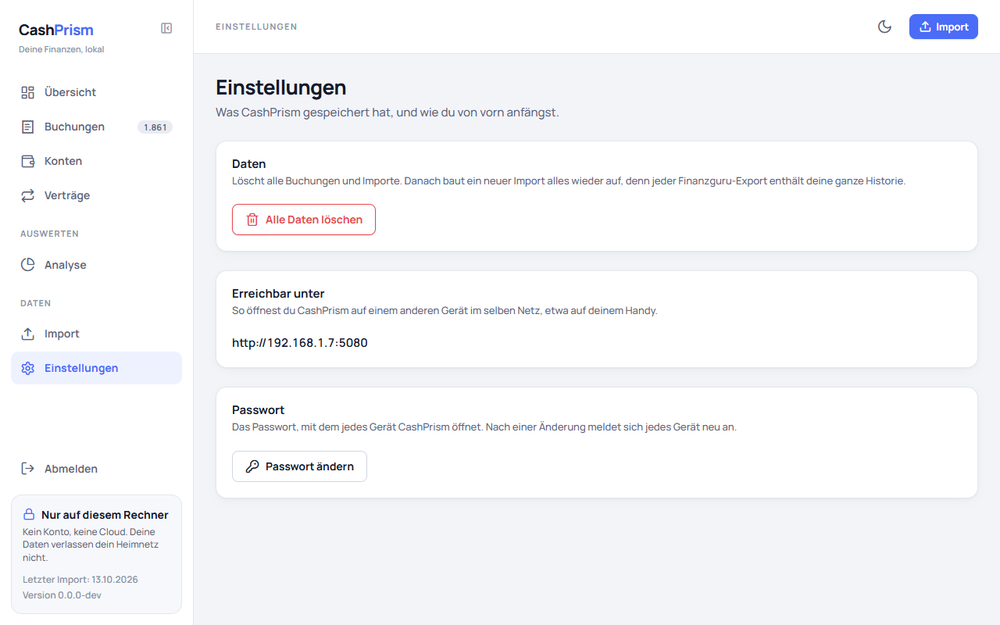

Laptop, Tablet oder Handy im selben Netz öffnen die Adresse unter
*From another device in the same network* im Browser. Dieselben Adressen
stehen in CashPrism unter *Einstellungen* auf der Karte *Erreichbar unter*,
falls das Konsolenfenster schon zu ist. Stehen dort mehrere Zeilen, ist das
normal — VPN- oder Docker-Adapter bringen eigene Adressen mit. Man probiert sie
der Reihe nach, bis eine antwortet.

Läuft CashPrism in einem Container, nennt die Karte nur den Port: Erreichbar
ist es dann unter der Adresse des Rechners, auf dem der Container läuft, mit
dem Port, unter dem er veröffentlicht ist.

Jedes Gerät meldet sich mit dem gemeinsamen Passwort an — siehe
[Anmelden](#anmelden).

## Passwort festlegen

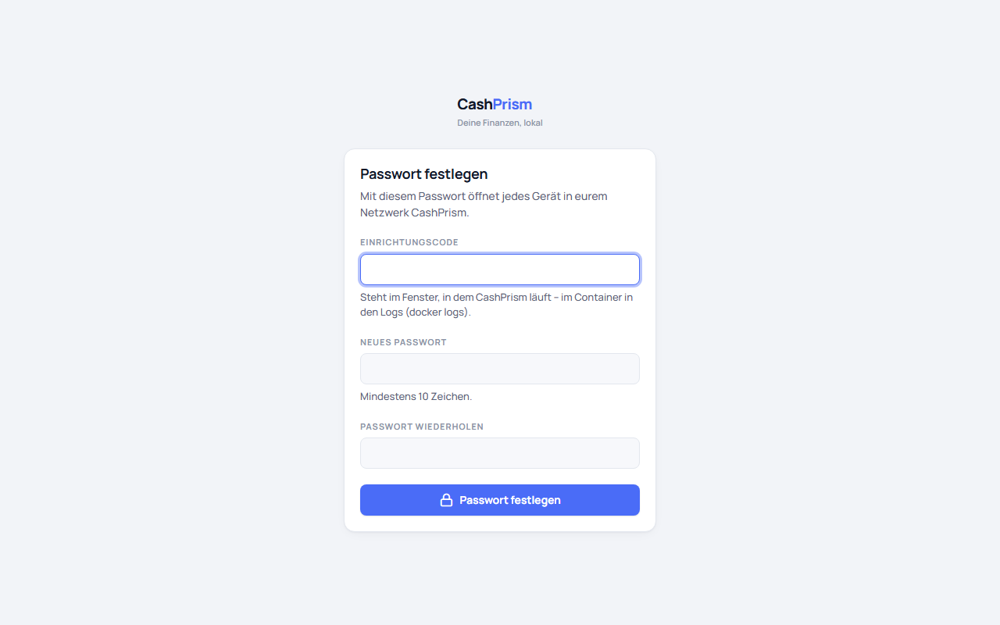

CashPrism ist mit einem Passwort geschützt, das sich der ganze Haushalt teilt.
Beim allerersten Start gibt es noch keins: Jede Seite führt dann zu
*Passwort festlegen*.

Dort braucht es den **Einrichtungscode**. Er steht im Konsolenfenster, in dem
CashPrism läuft, unter *No password is set yet* — beim Container in den Logs:

```bash
docker logs <Name des Containers>
```

Der Code beweist, dass hier jemand das Passwort festlegt, der Zugriff auf den
Rechner hat, und nicht irgendwer im WLAN. Er gilt nur bis zum nächsten Start:
Jeder Start, solange noch kein Passwort festgelegt ist, schreibt einen neuen.
Sobald das Passwort festgelegt ist, gilt er nicht mehr und erscheint auch nicht
mehr.

Das Passwort braucht mindestens 10 Zeichen, sonst nichts — keine Ziffern- oder
Sonderzeichenpflicht. Ein Satz aus ein paar Wörtern ist leichter zu merken und
schwerer zu erraten als ein kurzes Passwort voller Sonderzeichen. Es wird
zweimal eingegeben, damit sich kein Tippfehler einschleicht. Ändern lässt es
sich später unter *Einstellungen* — siehe [Passwort ändern](#passwort-ändern).

## Anmelden

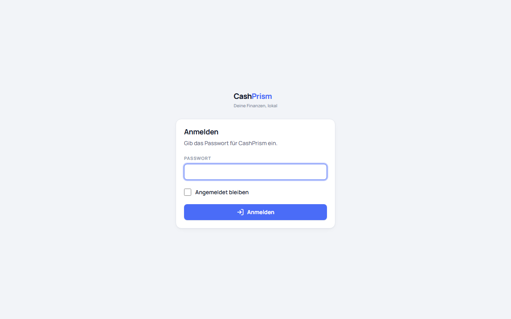

Jedes Gerät meldet sich einmal mit dem Passwort an. *Angemeldet bleiben* ist
ausgeschaltet:

- **Aus:** Die Anmeldung endet, wenn der Browser geschlossen wird.
- **An:** Die Anmeldung hält 30 Tage und verlängert sich mit jeder Benutzung.
  Das ist für das eigene Handy oder den eigenen Laptop gedacht, nicht für ein
  Gerät, das auch andere benutzen.

Nach fünf falschen Passwörtern hintereinander nimmt CashPrism eine Minute lang
keine Anmeldung an, auch nicht das richtige Passwort. Jede weitere Sperre
dauert doppelt so lange, höchstens 15 Minuten. Die Sperre gilt für alle Geräte
zugleich, und ein Neustart von CashPrism hebt sie auf. Das richtige Passwort
nach Ablauf der Sperre setzt alles zurück.

## Abmelden

*Abmelden* steht unten in der Navigation, über dem Hinweis *Nur auf diesem
Rechner*. Es beendet die Anmeldung auf diesem Gerät; die anderen bleiben
angemeldet.

## Passwort ändern

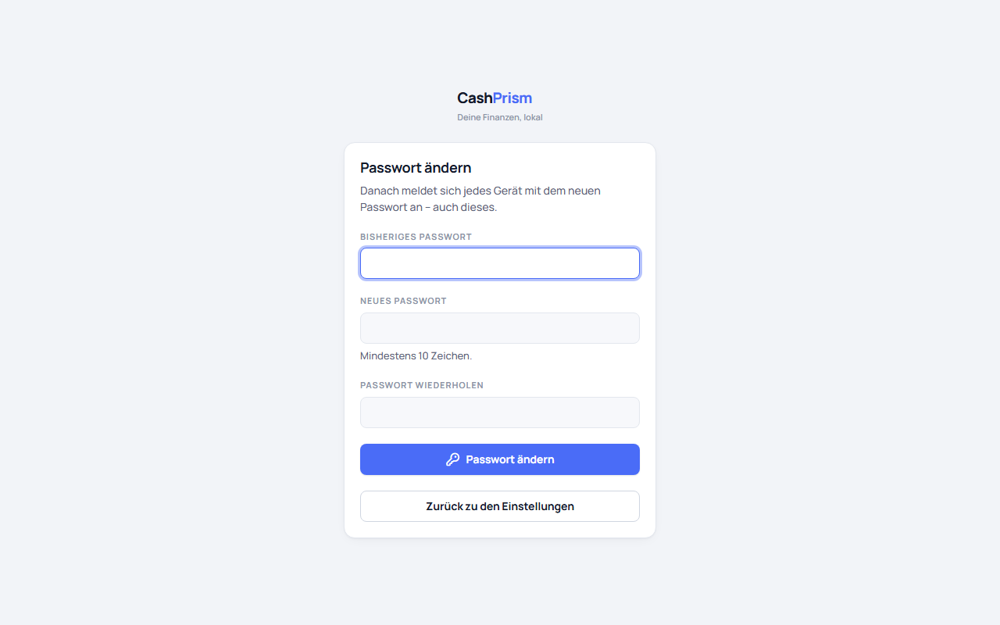

Unter *Einstellungen* führt *Passwort ändern* zu einer eigenen Seite. Dort
stehen das bisherige Passwort und zweimal das neue, mit denselben Regeln wie
beim Festlegen. Ein falsches bisheriges Passwort zählt wie ein falsches beim
Anmelden, auch für die Sperre.

Nach der Änderung ist **jedes Gerät abgemeldet**, auch das, auf dem geändert
wurde: Es landet auf *Anmelden* und meldet sich mit dem neuen Passwort an.
Eine Seite, die auf einem anderen Gerät gerade offen ist, merkt das erst, wenn
sie neu geladen wird.

## Passwort vergessen

CashPrism kennt kein Konto und keine E-Mail-Adresse, über die sich ein
vergessenes Passwort zurückholen ließe. Zurücksetzen kann es deshalb nur, wer
CashPrism startet: CashPrism beenden und einmal mit `--reset-password` starten.

- **Windows**, in PowerShell im Ordner von CashPrism:

  ```powershell
  .CashPrism.Shell.exe --reset-password
  ```

- **macOS und Linux**, im Terminal im Ordner von CashPrism:

  ```bash
  ./CashPrism.Shell --reset-password
  ```

- **Container:** den laufenden anhalten, denn zwei Container auf denselben
  Daten gehen nicht, und einmal mit dem Schalter im Vordergrund starten:

  ```bash
  docker stop <Name des Containers>
  docker run --rm -p 5080:5080 -v cashprism-data:/data -e TZ=Europe/Berlin ghcr.io/raisr/cashprism --reset-password
  ```

  Ist das neue Passwort festgelegt, beendet `Strg+C` diesen Container, und
  `docker start <Name des Containers>` startet den gewohnten wieder.

- **Aus dem Quellcode:** `dotnet run --project src/CashPrism.Shell -- --reset-password`

Danach steht im Fenster wieder ein Einrichtungscode, und es geht weiter wie
unter [Passwort festlegen](#passwort-festlegen). Buchungen und Importe bleiben
dabei erhalten; jedes Gerät ist abgemeldet. Der nächste Start ohne den Schalter
setzt nichts mehr zurück.

## Die Navigation

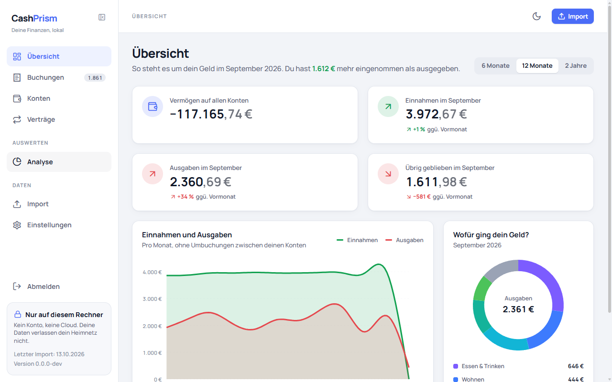

Links steht die Navigation mit sieben Zielen. Auf einem schmalen Bildschirm ist
sie eingeklappt und öffnet sich über das Menüsymbol oben links. Oben rechts
wechselt ein Schalter zwischen hellem und dunklem Design, und die Schaltfläche
*Import* führt von jeder Seite direkt zum Einlesen. Unten in der Navigation
steht, welche Version von CashPrism läuft. Auf einem breiten Bildschirm klappt
das Symbol neben dem Schriftzug die Navigation zu einer schmalen Leiste aus
Symbolen ein und wieder auf.

| Ziel | Adresse | Was dort ist |
|---|---|---|
| Übersicht | `/` | Einnahmen, Ausgaben und wofür das Geld ging — siehe [Die Übersicht](#die-übersicht) |
| Buchungen | `/bookings` | Alle gespeicherten Buchungen als Liste |
| Konten | `/accounts` | Deine Konten mit ihren Kontoständen, in Gruppen deiner Wahl — siehe [Die Konten](#die-konten) |
| Verträge | `/contracts` | Was Finanzguru als Vertrag erkannt hat, nach Rhythmus gruppiert — siehe [Die Verträge](#die-verträge) |
| Analyse | `/analysis` | Ausgaben nach Kategorie über mehrere Monate verglichen, dazu nach Empfänger — siehe [Die Analyse](#die-analyse) |
| Import | `/import` | Einen Finanzguru-Export einlesen, darunter die bisherigen Importe |
| Einstellungen | `/settings` | Alle gespeicherten Daten löschen, sehen, unter welcher Adresse CashPrism erreichbar ist, Passwort ändern |

Solange nichts importiert ist, zeigen *Übersicht*, *Buchungen*, *Konten*, *Verträge* und *Analyse* statt
leerer Zahlen einen Hinweis und eine Schaltfläche zur Seite *Import*.

## Die Übersicht

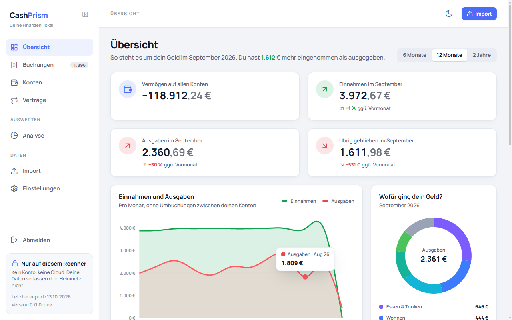

Die Übersicht rechnet vom Datum des jüngsten Exports aus, nicht vom heutigen
Tag. Der Monat, in dem der Export gezogen wurde, läuft noch; der Monat davor
ist der letzte vollständige.

**Was zählt:** CashPrism rechnet wie die Analyse in der Finanzguru-App, damit
du dieselben Zahlen siehst. Eine Umbuchung zwischen deinen eigenen Konten ist
weder Einnahme noch Ausgabe. Von einer geteilten Buchung zählen die Teile,
nicht die ursprüngliche Buchung. Dann wird jede Hauptkategorie für den Monat
zusammengerechnet: Bleibt unterm Strich ein Plus, zählt sie zu den Einnahmen,
bleibt ein Minus, zu den Ausgaben. Eine Erstattung macht deshalb die Ausgaben
ihrer Kategorie kleiner, statt als Einnahme zu zählen. Umgekehrt kann eine
Kategorie in einem Monat als Einnahme erscheinen, etwa *Sparen* bei einer
Auszahlung oder *Finanzen* bei einer Steuererstattung. Ob Finanzguru eine
Buchung vom frei verfügbaren Einkommen ausnimmt, spielt hier keine Rolle.

- **Vermögen auf allen Konten:** die erste Kachel. Sie zählt die Kontostände
  aller [Konten](#die-konten) zusammen, ein Kredit mit seinem Minus.
- **Kacheln:** *Einnahmen*, *Ausgaben* und was *übrig geblieben* ist, jeweils im
  letzten vollständigen Monat und auf den Cent. Darunter steht die Veränderung
  gegenüber dem Monat davor — bei Einnahmen und Ausgaben in Prozent, beim
  Übriggebliebenen in Euro, weil ein Prozentwert auf einen kleinen oder
  negativen Betrag nichts sagt. Hatte der Vormonat keine Einnahmen oder keine
  Ausgaben, fehlt die Prozentangabe. Der Pfeil im runden Symbol zeigt, in
  welche Richtung sich der Wert bewegt hat; grün heißt mehr Einnahmen, weniger
  Ausgaben oder mehr übrig, rot das Gegenteil, grau keine Veränderung oder
  nichts zum Vergleichen.
- **Diagramm:** Einnahmen und Ausgaben pro Monat. Oben rechts wählst du
  *6 Monate*, *12 Monate* oder *2 Jahre*. Der letzte Punkt ist der laufende
  Monat; er trägt auf der Achse einen Stern und fällt meist steil ab, weil der
  Export vor seinem Ende gezogen wurde. Zeigst du auf einen Punkt, nennt ein
  Kästchen darüber Einnahmen oder Ausgaben, Monat und Betrag.
- **Wofür ging dein Geld?** Die Ausgaben des letzten vollständigen Monats nach
  den Hauptkategorien aus Finanzguru, die unterm Strich Geld gekostet haben,
  jeweils mit ihrem Saldo: die fünf größten einzeln, alle weiteren
  zusammen als *Übrige*. Das sind Finanzgurus eigene Kategorien, nicht die
  zusammengefassten der Buchungsliste. Zeigst du auf ein Stück des Rings,
  nennt ein Kästchen Kategorie und Betrag. Ein Klick auf ein Stück oder auf
  einen Eintrag daneben öffnet die [Buchungsliste](#die-buchungsliste) mit den
  Buchungen dieser Kategorie in diesem Monat, Umbuchungen ausgeblendet; ihr
  *Saldo* ist dann genau der Betrag aus dem Ring. *Übrige* öffnet nichts, weil
  es für mehrere Kategorien steht.
- **Demnächst:** die Vertragsbuchungen, die in den 30 Tagen nach dem Export
  erwartet werden, mit Tag und Betrag — wie die Spalte *Nächste Buchung* auf
  der Seite [Verträge](#die-verträge) sie berechnet. Überfällige Buchungen
  stehen oben, die am längsten überfälligen zuerst, darunter der Rest nach
  Datum. Auch eine Buchung, die schon fällig, aber noch nicht überfällig ist,
  steht hier. Einen Hinweis ausblenden kannst du nur auf *Verträge*; *Alle
  Verträge* führt dorthin.

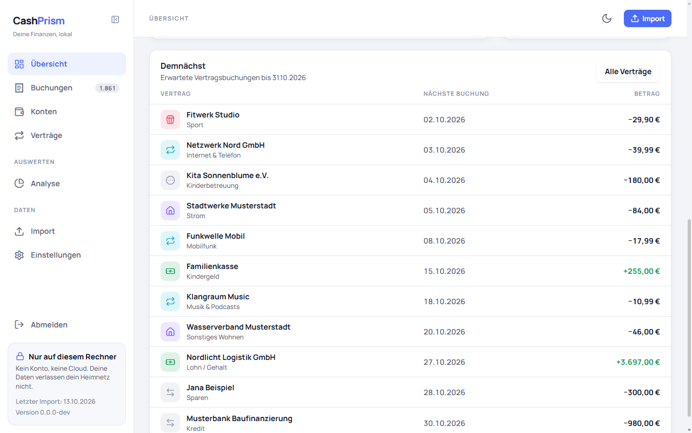

## Die Analyse

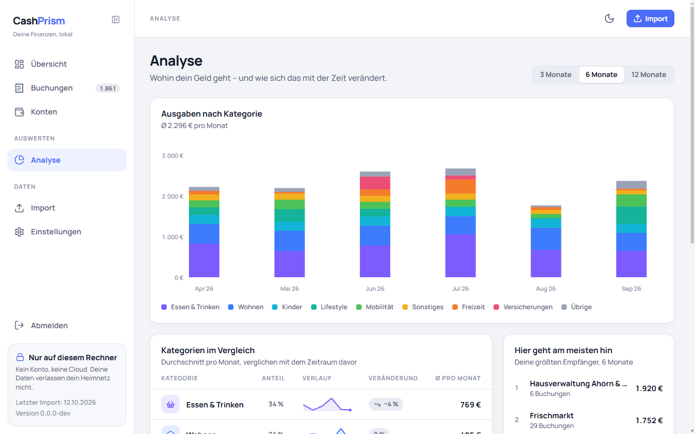

Die Analyse vergleicht, wofür und an wen du über mehrere Monate Geld
ausgegeben hast. Oben rechts wählst du *3 Monate*, *6 Monate* oder *12 Monate*.
Gemeint sind immer die letzten vollständigen Monate vor dem Monat, in dem der
jüngste Export gezogen wurde; der laufende Monat zählt nicht mit, weil er den
Durchschnitt zu niedrig ausfallen ließe. Gezählt wird wie auf der
[Übersicht](#die-übersicht): Eine Hauptkategorie, die in einem Monat unterm
Strich ein Plus hatte, hat in diesem Monat nichts gekostet.

- **Ausgaben nach Kategorie:** Pro Monat ein Balken, in dem die
  Hauptkategorien übereinander stehen. Darüber steht, was du im gewählten
  Zeitraum im Schnitt pro Monat ausgegeben hast. Die acht Kategorien mit den
  höchsten Ausgaben der letzten zwölf Monate haben je eine eigene Farbe, alle
  weiteren stehen zusammen als *Übrige*. Zeigst du auf einen Block, nennt ein
  Kästchen darüber Kategorie, Monat und Betrag.
- **Kategorien im Vergleich:** Jede Hauptkategorie, die im Zeitraum oder im
  gleich langen Zeitraum davor Geld gekostet hat, die teuerste zuerst. Zu
  sehen sind ihr Anteil an allen Ausgaben, eine kleine Verlaufslinie über die
  Monate und der Durchschnitt pro Monat. *Veränderung* vergleicht mit dem
  Zeitraum davor: rot, wenn du mindestens fünf Prozent mehr ausgegeben hast,
  grün bei mindestens fünf Prozent weniger, grau dazwischen. *neu* heißt, dass
  die Kategorie im Zeitraum davor nichts gekostet hat. Ist die Tabelle schmal,
  fällt zuerst der Balken beim Anteil weg, dann die Verlaufslinie; die Zahlen
  bleiben. Ein Klick auf den Namen einer Kategorie öffnet die
  [Buchungsliste](#die-buchungsliste) mit ihren Buchungen im gewählten
  Zeitraum, Umbuchungen ausgeblendet. Die Blöcke im Diagramm darüber öffnen
  nichts.
- **Hier geht am meisten hin:** Neben der Tabelle, auf einem schmalen
  Bildschirm darunter, steht, wer im gewählten Zeitraum wie viel Geld bekommen
  hat, der größte Betrag zuerst, mit der Zahl der Buchungen und der Summe in
  ganzen Euro. Gezählt werden nur Ausgaben, Buchung für Buchung: Umbuchungen
  zwischen deinen eigenen Konten zählen nicht, von einer geteilten Buchung
  zählen die Teile statt der ursprünglichen Buchung, und eine Erstattung wird
  nicht verrechnet — anders als bei den Kategorien. Der Name steht genau so da,
  wie Finanzguru ihn exportiert. Schreibt Finanzguru denselben Händler auf zwei
  Arten, etwa einmal mit und einmal ohne Filialnummer, erscheint er zweimal.
  Eine Buchung ohne Empfänger fehlt in der Liste. Zu sehen sind zuerst die acht
  größten; *Alle … anzeigen* zeigt den Rest, *Weniger anzeigen* klappt ihn
  wieder ein. Ein Klick auf einen Empfänger öffnet die
  [Buchungsliste](#die-buchungsliste) mit genau diesen Buchungen: dieser
  Empfänger, dieser Zeitraum, nur Ausgaben, Umbuchungen ausgeblendet. Ihre
  Summenzeile nennt dieselben Ausgaben auf den Cent. Nur die Zahl der Buchungen
  kann dort höher liegen, weil die Liste von einer geteilten Buchung auch das
  Original zeigt.

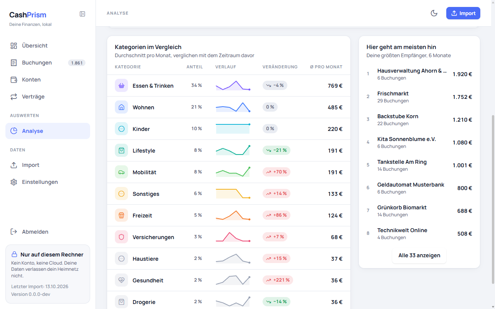

Die Farben richten sich nach dem Rang einer Kategorie, nicht nach ihrem Namen.
Beim Umschalten des Zeitraums behält jede Kategorie ihre Farbe, und eine
Kategorie, die Finanzguru umbenennt oder neu einführt, bekommt trotzdem eine.
Das Symbol in der Tabelle kennt CashPrism dagegen nur für die Kategorien, die
es aus Finanzguru kennt; jede andere erhält ein allgemeines Symbol.

## Einen Export importieren

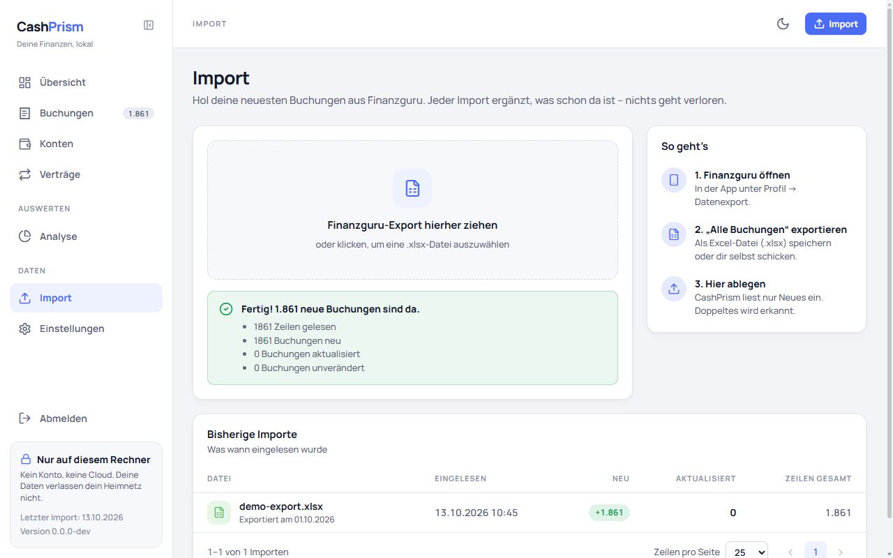

CashPrism liest den Finanzguru-Export „Alle Buchungen“ als `.xlsx`-Datei.

1. *Import* öffnen.
2. Die Datei auf die Fläche *Finanzguru-Export hierher ziehen* ziehen — oder
   auf die Fläche klicken und die Datei wählen.
3. Warten, bis *Wird eingelesen …* verschwindet. Bei einigen tausend Buchungen
   dauert das wenige Sekunden.

Neben der Fläche steht unter *So geht’s*, wo Finanzguru den Export anbietet.

Wer CashPrism ohne eigenen Export ausprobieren möchte, importiert
[`samples/demo-export.xlsx`](../samples/demo-export.xlsx) aus dem Repository:
drei Jahre eines erfundenen Haushalts, aufgebaut wie ein echter
Finanzguru-Export. Alle Namen und Beträge darin sind ausgedacht.

Während der Import läuft, ist die Seite abgedunkelt: Die Navigation ist nicht
erreichbar, und ein zweiter Import lässt sich nicht starten.

Dateien über 64 MB liest CashPrism nicht ein. Ein Finanzguru-Export ist weit
kleiner.

### Was die vier Zahlen bedeuten

Nach einem erfolgreichen Import meldet die Seite *Fertig! … neue Buchungen sind
da.* — oder *Fertig! Keine neuen Buchungen.*, wenn der Export nichts Neues
enthielt — und darunter vier Zahlen:

| Zahl | Bedeutet |
|---|---|
| gelesen | Wie viele Buchungszeilen die Datei enthielt |
| neu | Buchungen, die CashPrism zum ersten Mal gespeichert hat |
| aktualisiert | Gespeicherte Buchungen, die durch einen neueren Stand ersetzt wurden — etwa weil in Finanzguru die Kategorie oder die Gegenseite korrigiert wurde |
| unverändert | Buchungen, die so blieben, wie sie waren |

*Neu*, *aktualisiert* und *unverändert* ergeben zusammen die Zahl der gelesenen
Zeilen.

Hat der Import Buchungen entfernt, steht darunter eine fünfte Zeile: *… Buchungen
entfernt, weil der Export sie nicht mehr enthält*. Ohne entfernte Buchung fehlt
sie.

CashPrism erkennt eine Buchung an der Buchungs-ID, die Finanzguru ihr gibt.
Dieselbe Buchung wird deshalb nie doppelt gespeichert. Jeder Export enthält
alle deine Buchungen, und CashPrism zeigt genau die des neuesten Exports.
Fehlt darin eine Buchung, die ein früherer Export noch hatte — etwa weil du in
Finanzguru ein Konto entfernt hast —, entfernt der Import sie auch hier.

Welcher Export der neueste ist, entscheidet das Exportdatum, das Finanzguru in
den Namen des Tabellenblatts schreibt. Ein älterer Export ändert nichts: Er
fügt keine Buchung hinzu, entfernt keine und überschreibt keine. Seine
Buchungen zählen als *unverändert*, auch wenn sie anders aussehen als die
gespeicherten.

Meldet der Import *Unbekannte Spalten im Export*, wurde die Datei trotzdem
eingelesen. Der Hinweis bedeutet, dass Finanzguru das Exportformat geändert hat
und diese Version von CashPrism die genannten Spalten noch nicht kennt.

### Dieselbe Datei zweimal

Wird eine Datei importiert, die schon einmal eingelesen wurde, meldet CashPrism
*Diese Datei kennen wir schon*. Dabei wird nichts gespeichert, und unter
*Bisherige Importe* erscheint kein neuer Eintrag.
CashPrism erkennt die Datei an ihrem Inhalt, nicht am Namen: Eine umbenannte
Kopie gilt als dieselbe Datei.

### Wenn eine Datei abgelehnt wird

Passt eine Datei nicht, meldet die Seite *Das ist keine Finanzguru-Datei* und
nennt darunter die Gründe — etwa eine fehlende Spalte, eine leere Pflichtzelle
oder einen Wert, der kein Datum ist, jeweils mit Spalte und Zeile. Abgelehnt
wird die ganze Datei; es wird nichts davon gespeichert.

Die Seite zeigt höchstens 20 Gründe. Sind es mehr, sagt die letzte Zeile, wie
viele fehlen. Die vollständige Liste steht im Konsolenfenster des Rechners, auf
dem CashPrism läuft — auf Englisch, weil sie für eine Fehlermeldung an die
Entwickler gedacht ist.

Ist die Datei zu groß oder bricht das Hochladen ab, erscheint nur eine einzelne
Meldung ohne Liste: *Die Datei ist … MB groß* oder *Die Datei konnte nicht
gelesen werden.*

## Die Buchungsliste

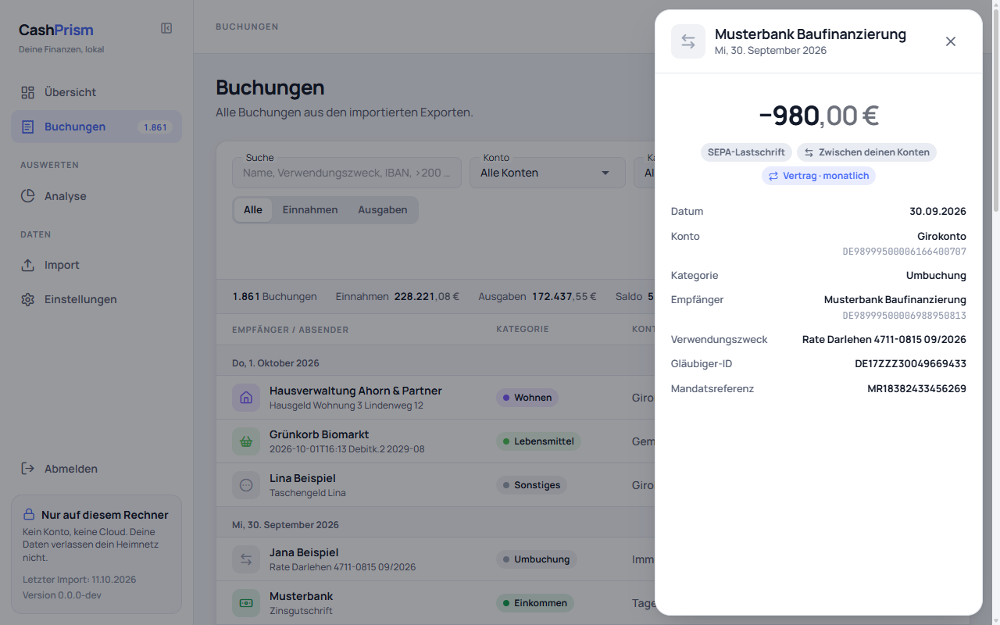

*Buchungen* zeigt alle gespeicherten Buchungen, zu Beginn die neuesten oben,
nach Tagen gruppiert: über den Buchungen eines Tages steht *Heute*, *Gestern*
oder das Datum mit Wochentag, etwa *Mo, 28. September 2026*.

| Spalte | Enthält |
|---|---|
| Empfänger / Absender | Wer bezahlt hat oder bezahlt wurde, davor das Symbol der Kategorie und darunter der Verwendungszweck. Lange Verwendungszwecke werden abgeschnitten; der ganze Text erscheint, wenn der Mauszeiger darauf ruht |
| Kategorie | Die Kategorie mit ihrer Farbe — siehe unten |
| Konto | Das Konto, wie Finanzguru es nennt |
| Datum | Das Buchungsdatum |
| Betrag | Der Betrag mit Vorzeichen, etwa `−12,50 €` oder `+1.850,00 €`. Euro-Beträge tragen das €-Zeichen, Beträge in einer anderen Währung deren Code, etwa `−4,00 USD`. Eingänge sind grün, Ausgänge in der normalen Schriftfarbe — das Vorzeichen sagt es auch ohne Farbe |

**Kategorien:** CashPrism fasst die Kategorien aus Finanzguru zu elf eigenen
zusammen, jede mit fester Farbe und eigenem Symbol: Wohnen, Mobilität,
Verträge & Abos, Versicherungen, Lebensmittel, Gesundheit, Shopping,
Freizeit & Essen, Einkommen, Umbuchung und Sonstiges. Restaurants und
Lieferdienste zählen zu *Freizeit & Essen*, Mobilfunk, Streaming, Cloud-Dienste,
Internet und Rundfunkbeitrag zu *Verträge & Abos*. Eine Buchung, die Finanzguru
als Umbuchung zwischen deinen eigenen Konten erkennt, ist immer *Umbuchung*.

**Sortieren:** *Empfänger / Absender*, *Datum* und *Betrag* lassen sich
sortieren. Der erste Klick auf eine dieser Überschriften sortiert absteigend,
der zweite aufsteigend, der dritte stellt die Liste wieder nach Tagen gruppiert
dar. Solange nach einer Spalte sortiert wird, fallen die Tagesüberschriften
weg.

**Blättern:** Unter der Liste steht, welche Buchungen gerade zu sehen sind, etwa
*1–25 von 6.327 Buchungen*, daneben die Seitenzahlen und die Pfeile zur
vorigen und nächsten Seite. Unter *Zeilen pro Seite* lassen sich 25, 50 oder
100 Buchungen pro Seite wählen. Alle auf einmal anzuzeigen ist bewusst nicht
vorgesehen.

**Details einer Buchung:** Ein Klick auf eine Buchung öffnet rechts ein Fenster
mit Betrag, Datum, Konto, Kategorie, Empfänger oder Absender und
Verwendungszweck. Unter dem Namen des Kontos steht seine IBAN, unter Empfänger
oder Absender dessen IBAN, wenn Finanzguru sie kennt. Bei einer Lastschrift
folgen *Gläubiger-ID* und *Mandatsreferenz*, und hast du der Buchung in
Finanzguru Tags gegeben, stehen sie unter *Tags*. Was eine Buchung nicht hat,
fehlt einfach, statt leer dazustehen. Unter dem Betrag steht, wie bezahlt wurde,
etwa *Kartenzahlung* oder *Überweisung*. Umbuchungen zwischen deinen eigenen
Konten sind dort als *Zwischen deinen Konten* markiert, und eine Buchung, die
Finanzguru einem Vertrag zuordnet, als *Vertrag* mit ihrem Rhythmus, etwa
*Vertrag · monatlich*. Mit der Tastatur geht es
ebenso: Mit Tab zur Buchung, mit Enter öffnen. Esc, das Kreuz oben rechts oder
ein Klick neben das Fenster schließen es wieder.

**Filtern:** Über der Liste schränkst du ein, welche Buchungen sie zeigt. Jeder
Filter nimmt einen Wert; mehrere Filter gelten zusammen.

| Filter | Wirkt so |
|---|---|
| Konto | Nur die Buchungen eines Kontos |
| Kategorie | Nur eine Hauptkategorie aus Finanzguru, so wie die [Analyse](#die-analyse) sie zeigt — nicht die zusammengefassten Kategorien der Liste. Ist eine gewählt, erscheint daneben *Unterkategorie*, um weiter einzuschränken |
| Zeitraum | *Dieser Monat*, *Letzter Monat*, *Letzte 12 Monate*, *Dieses Jahr* und *Letztes Jahr* rechnen wie die Übersicht vom Datum des jüngsten Exports aus, nicht vom heutigen Tag, und umfassen immer ganze Kalendermonate. *Eigener Zeitraum* zeigt zwei Felder *Von* und *Bis*; der Filter greift, sobald beide gesetzt sind |
| Alle / Einnahmen / Ausgaben | Nur Geld, das hereinkam, oder nur Geld, das hinausging — am Vorzeichen des Betrags |
| Umbuchungen ausblenden | Lässt Umbuchungen zwischen deinen eigenen Konten weg. Beim Öffnen der Seite ist der Schalter aus |

Ist ein Empfänger oder Absender als Filter gesetzt, steht er als Feld mit
Kreuz unter den Filtern; ein Klick darauf nimmt ihn wieder weg. Eingeben lässt
er sich auf dieser Seite nicht — er kommt über einen Link, der genau diesen
Namen trägt. Ebenso ein Vertrag: Ein Klick auf einen Namen auf der Seite
[Verträge](#die-verträge) zeigt nur dessen Buchungen, und das Feld *Vertrag*
unter den Filtern nimmt die Einschränkung wieder weg.

Die Filter stehen in der Adresse der Seite, etwa
`/bookings?account=…&from=2026-09-01&to=2026-09-30`. Ein Neuladen behält sie,
der Zurück-Knopf des Browsers geht zum vorigen Filter zurück, und eine
gespeicherte Adresse zeigt beim nächsten Öffnen dieselbe Auswahl. Ein Zeitraum
steht dort immer als zwei feste Daten: *Letzter Monat* bleibt in einem
Lesezeichen derselbe Monat, auch wenn später ein neuerer Export dazukommt.
Sortierung, Seite und *Zeilen pro Seite* stehen ebenfalls in der Adresse.

Passt keine Buchung zum Filter, sagt die Seite *Keine Buchung passt zu diesem
Filter.*; *Filter zurücksetzen* nimmt alle Filter weg und behält die
Sortierung.

**Die Zeile über der Liste** zählt alle Buchungen, die der Filter zeigt — nicht
nur die auf der aktuellen Seite — und nennt ihre *Einnahmen*, ihre *Ausgaben*
und den *Saldo* daraus. Einnahmen sind die Summe aller positiven Beträge,
Ausgaben die aller negativen; anders als auf der Übersicht wird nichts pro
Kategorie verrechnet. Von einer geteilten Buchung zeigt die Liste auch die
ursprüngliche Buchung, so wie der Export sie enthält; in die Summen geht sie
nicht ein, weil ihre Teile schon gezählt sind. Umbuchungen zählen mit, solange
sie gezeigt werden.

**Suchen:** Das Feld *Suche* vorne in der Filterzeile findet Buchungen nach
dem, was du noch weißt. Die Suche greift, sobald du Enter drückst oder das
Feld verlässt; das Kreuz im Feld leert sie wieder. Sie gilt zusammen mit den
Filtern und steht wie sie in der Adresse, etwa `/bookings?q=rewe`.

- **Wörter** werden in Empfänger oder Absender, im Verwendungszweck und in der
  IBAN gesucht, auch als Teil eines Wortes. Mehrere Wörter müssen alle
  vorkommen: `rewe berlin` findet „REWE Markt Berlin-Mitte“, aber nicht „REWE
  Hamburg“.
- **Groß- und Kleinschreibung** spielen keine Rolle, Umlaute eingeschlossen.
  Weil Banken Umlaute oft umschreiben, findet `möbel` auch „MOEBEL“ und
  `moebel` auch „Möbel“; ebenso `strasse` und „Straße“. Andere Akzente zählen
  nicht: `cafe` findet „Café“.
- **Beträge** suchst du mit einem Zeichen davor: `>200` (mehr als 200 €),
  `>=200`, `<50`, `<=50` oder `=12,99` (genau). Komma und Punkt gehen beide,
  ein `€` oder `EUR` dahinter wird ignoriert. Verglichen wird der Betrag ohne
  Vorzeichen: `>200` findet Ausgaben und Einnahmen über 200 €; welche Seite du
  sehen willst, wählst du mit *Einnahmen* oder *Ausgaben*. Mehrere Angaben
  gelten zusammen: `>300 <400 rewe` findet REWE-Buchungen zwischen 300 und
  400 €.
- Was sich nicht als Betrag lesen lässt, etwa `>abc` oder `>1.000,00` mit
  Tausenderpunkt, wird als Wort gesucht.

## Die Konten

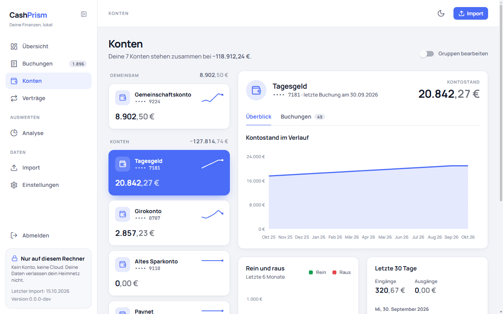

*Konten* zeigt jedes Konto aus deinem Finanzguru-Export mit seinem Kontostand.
Darüber steht, wo deine Konten zusammen stehen, etwa *Deine 7 Konten stehen
zusammen bei 25.446,00 €*. Ein Kredit zählt mit seinem Minus, die Summe kann
also negativ sein.

- **Gruppen:** links stehen deine Konten in Gruppen, jede mit ihrem Namen und
  der Summe ihrer Kontostände. Am Anfang gibt es eine einzige Gruppe, *Konten*;
  wie du weitere anlegst, steht unter [Kontogruppen](#kontogruppen).
- **Kontokarten:** in jeder Gruppe in der Reihenfolge, die du festgelegt hast.
  Jede Karte zeigt den Namen des Kontos, wie Finanzguru ihn führt, die letzten
  vier Stellen der IBAN, etwa `•••• 2051`, den Kontostand und eine kleine
  Linie, wie er sich über die letzten fünf Monatsenden bis zum neuesten Export
  entwickelt hat. Ein Klick wählt das Konto aus; die ausgewählte Karte ist
  blau. Die Auswahl steht in der Adresse, ein Lesezeichen öffnet also dasselbe
  Konto. Ohne Auswahl ist das Konto mit dem höchsten Guthaben ausgewählt.
- **Das ausgewählte Konto:** rechts, mit Kontostand und dem Tag der letzten
  Buchung. Darunter wechselst du zwischen zwei Ansichten, *Überblick* und
  *Buchungen*. Beim Öffnen der Seite ist *Überblick* gewählt.
- ***Überblick*:** *Kontostand im Verlauf* zeigt den Kontostand am Ende der
  letzten zwölf Monate und am Tag des neuesten Exports; zeigst du auf einen
  Punkt, steht der Stand dabei. Darunter zwei Karten:
  - *Rein und raus* zeigt für die letzten sechs abgeschlossenen Monate, was
    auf das Konto kam und was es verließ, als Balken nebeneinander.
  - *Letzte 30 Tage* zählt die *Eingänge* und *Ausgänge* der 30 Tage bis zum
    neuesten Export zusammen und zeigt die vier neuesten dieser Buchungen; ein
    Klick öffnet die [Details einer Buchung](#die-buchungsliste).

  Anders als in der Übersicht und der Analyse zählen hier **Umbuchungen** mit:
  Zwischen deinen eigenen Konten bewegen sie insgesamt kein Geld, auf diesem
  Konto aber schon. Jede Buchung zählt nach ihrem Vorzeichen, eine Erstattung
  also als Eingang. Eine geteilte Buchung zählt einmal.
- ***Buchungen*:** die 30 neuesten Buchungen des Kontos nach Tagen, ihre
  Gesamtzahl steht am Reiter; ein Klick öffnet die [Details einer
  Buchung](#die-buchungsliste). *Alle Buchungen dieses Kontos* öffnet die
  Buchungsliste auf dieses Konto gefiltert.

**Woher der Kontostand kommt:** aus dem Export, so wie Finanzguru ihn am Tag
des Exports zeigt. CashPrism rechnet nichts nach und nimmt den Stand des
neuesten Exports, auch wenn du danach einen älteren importierst.

**Woher der Verlauf kommt:** CashPrism rechnet vom Kontostand des neuesten
Exports rückwärts und zieht jede spätere Buchung wieder ab, Umbuchungen
eingeschlossen. Das Ergebnis vergleicht es an jedem Monatsende mit dem
Kontostand, den der Export dort selbst nennt. Passt es auch nur an einem
Monatsende nicht, zeigt das Konto keinen Verlauf und keine Linie auf der
Karte, sondern einen Satz, warum — ein falscher Verlauf wäre schlimmer als
keiner. Vor der ersten Buchung eines Kontos weiß der Export nicht, was darauf
lag; dort beginnt die Linie erst später. Bucht Finanzguru eine Buchung
nachträglich mit einem früheren Datum, ändert sich mit dem nächsten Import auch
der Verlauf davor.

**Was fehlt:**

- **Konten ohne Buchung.** Der Export beschreibt ein Konto nur über seine
  Buchungen. Ein Konto, das in Finanzguru zu sehen ist, aber im Export keine
  einzige Buchung hat, erscheint hier nicht, und sein Kontostand fehlt in der
  Summe.
- **Der Name der Bank.** Der Export enthält ihn nicht.
- **Kontostände aus früheren Importen.** CashPrism liest den Kontostand beim
  Import. Hast du vor dieser Version importiert, erscheinen die Konten mit dem
  nächsten neuen Export. Denselben Export noch einmal zu importieren reicht
  nicht, er wird als bereits importiert erkannt.

### Kontogruppen

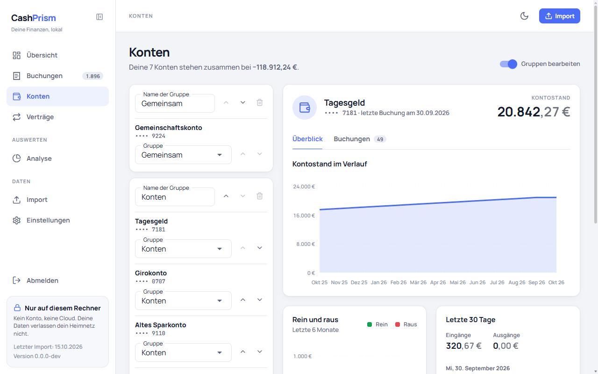

Wie in Finanzguru sortierst du deine Konten in Gruppen, die du selbst benennst,
etwa *Eigene*, *Gemeinsam* und *Kinder*. Der Export enthält keine Gruppen,
CashPrism merkt sie sich selbst. Der Schalter *Gruppen bearbeiten* oben rechts
macht aus der Liste ein Formular:

| Was | Wie |
|---|---|
| Gruppe anlegen | Den Namen unter *Neue Gruppe* eintragen und *Gruppe hinzufügen* klicken. Die neue Gruppe steht ganz unten |
| Gruppe umbenennen | Den Namen im Feld ändern und das Feld verlassen. Ein leerer Name wird nicht übernommen |
| Gruppe verschieben | Die Pfeile neben dem Namen |
| Gruppe löschen | Der Papierkorb. Er lässt sich nur bei einer leeren Gruppe anklicken, und nie bei der letzten |
| Konto in eine andere Gruppe stellen | Die Auswahl *Gruppe* am Konto. Es steht dort dann am Ende |
| Konto verschieben | Die Pfeile am Konto, innerhalb seiner Gruppe |

Jede Änderung gilt sofort, es gibt nichts zu speichern. Schaltest du den
Schalter wieder aus, siehst du die Karten in ihrer neuen Ordnung.

- **Neue Konten** aus einem Import stehen am Ende der obersten Gruppe, mehrere
  neue nach Kontostand, das höchste Guthaben zuerst.
- **Die Gruppen bleiben**, wenn du [alle Daten löschst](#alle-daten-löschen) und
  neu importierst: Jedes Konto steht danach wieder, wo es war. Nur wenn du beim
  Löschen *Kontogruppen ebenfalls löschen* ankreuzt, beginnst du wieder mit der
  einen Gruppe *Konten*.
- **Ein Konto, das der neueste Export nicht enthält,** fehlt auch in seiner
  Gruppe. Bringt ein späterer Export es zurück, steht es wieder an seinem Platz.
  Eine Gruppe, in der nur solche Konten stehen, gilt als leer und lässt sich
  löschen; kommt eines dieser Konten dann zurück, steht es am Ende der obersten
  Gruppe.

## Die Verträge

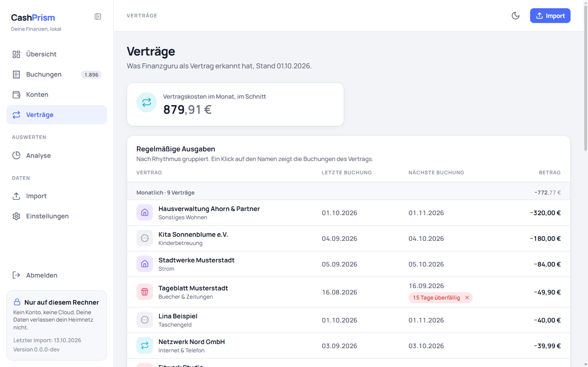

*Verträge* zeigt, was Finanzguru in deinen Buchungen als Vertrag erkannt hat —
dieselben Verträge, die du in der App siehst. CashPrism erkennt selbst nichts
und ändert nichts daran.

- **Vertragskosten im Monat, im Schnitt:** jeder laufende Ausgabenvertrag auf
  einen Monat umgerechnet und zusammengezählt. Ein jährlicher Vertrag über
  120 € zählt mit 10 €, ein vierteljährlicher über 30 € ebenfalls mit 10 €.
  Einnahmen, Umbuchungen und vermutlich beendete Verträge zählen nicht mit.
- **Regelmäßige Ausgaben:** nach Rhythmus gruppiert, *Monatlich* zuerst. Jede
  Gruppe nennt, wie viele Verträge sie hat und was sie zusammen kosten.
- **Regelmäßige Einnahmen** und **Regelmäßige Umbuchungen** stehen jeweils in
  einem eigenen Abschnitt, etwa dein Gehalt oder die monatliche Sparrate auf
  ein eigenes Konto.
- **Eine Zeile** zeigt den Namen, die Unterkategorie, den Tag der letzten
  Buchung, den Tag der nächsten und den Betrag der letzten. Ändert sich der
  Betrag eines Vertrags, steht hier der neueste. Ein Klick auf den Namen
  öffnet die [Buchungsliste](#die-buchungsliste) mit allen Buchungen dieses
  Vertrags.
- **Nächste Buchung:** der Tag der letzten Buchung plus der Rhythmus des
  Vertrags in Kalendermonaten — bei einem monatlichen Vertrag vom 31. Januar
  also der letzte Tag im Februar. CashPrism erwartet denselben Betrag wie bei
  der letzten Buchung. Der Export enthält keine Vorhersage; das ist
  berechnet, so wie es auch die App tut.
- **Überfällig:** Ist die nächste Buchung mehr als 5 Tage nach ihrem Tag
  ausgeblieben, gemessen am Datum des Exports, steht darunter *x Tage
  überfällig*. Die 5 Tage gelten für jeden Rhythmus: Vertragsbuchungen kommen
  oft ein paar Tage später als erwartet, aber kaum je später als vier Tage.
  Mit dem ✕ im Hinweis blendest du ihn aus — nur für diesen erwarteten Tag.
  Bleibt auch die übernächste Buchung aus, erscheint der Hinweis wieder.
- **Vermutlich beendet** steht ganz unten und ist zugeklappt. Dort landet ein
  Vertrag, bei dem mindestens zwei fällige Zahlungen ausgeblieben sind: bei
  einem monatlichen Vertrag also, wenn die letzte Buchung mehr als zwei Monate
  vor dem Export liegt. Finanzguru meldet im Export kein Vertragsende, deshalb
  ist das nur abgeleitet. Kommt wieder eine Buchung, steht der Vertrag wieder
  oben. Von einem vermutlich beendeten Vertrag erwartet CashPrism keine
  Buchung mehr.

**Einen Vertrag entfernen oder kündigen** machst du in Finanzguru. Entfernst du
dort einen Vertrag, ist er nach dem nächsten Import auch hier verschwunden.
Markierst du ihn dort als gekündigt, bleibt er hier stehen, bis seine Buchungen
lange genug ausbleiben — der Export enthält nicht, dass er gekündigt ist.

## Bisherige Importe

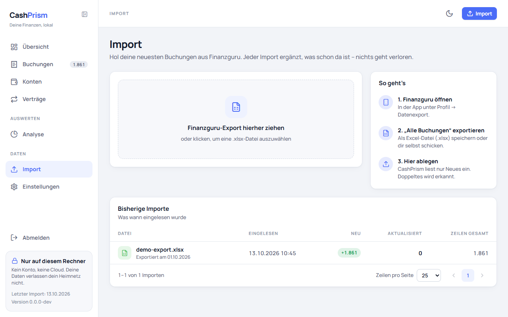

Unter der Fläche zum Einlesen listet *Bisherige Importe* jeden Import, der
etwas eingelesen hat, die neuesten oben. Vor dem ersten Import fehlt die Liste.
Die Reihenfolge ist fest; die Spalten lassen sich nicht sortieren.

| Spalte | Enthält |
|---|---|
| Datei | Der Dateiname beim Hochladen und darunter, wann Finanzguru die Datei erzeugt hat — gelesen aus dem Namen des Tabellenblatts, *Datum unbekannt*, wenn der Name kein Datum enthielt. Ruht der Mauszeiger auf dem Namen, erscheint die Prüfsumme der Datei |
| Eingelesen | Wann importiert wurde |
| Neu | Wie viele Buchungen der Import neu gespeichert hat. Hat er Buchungen entfernt, weil der Export sie nicht mehr enthielt, steht ihre Zahl rot daneben, etwa *−72* |
| Aktualisiert | Wie viele gespeicherte Buchungen er durch einen neueren Stand ersetzt hat |
| Zeilen gesamt | Wie viele Buchungszeilen die Datei enthielt |

Abgelehnte Dateien und Dateien, die schon einmal importiert waren, erscheinen
hier nicht: Sie haben nichts eingelesen. Einzelne Einträge lassen sich weder
löschen noch wiederholen, und ein Import lässt sich nicht rückgängig machen.

## Alle Daten löschen

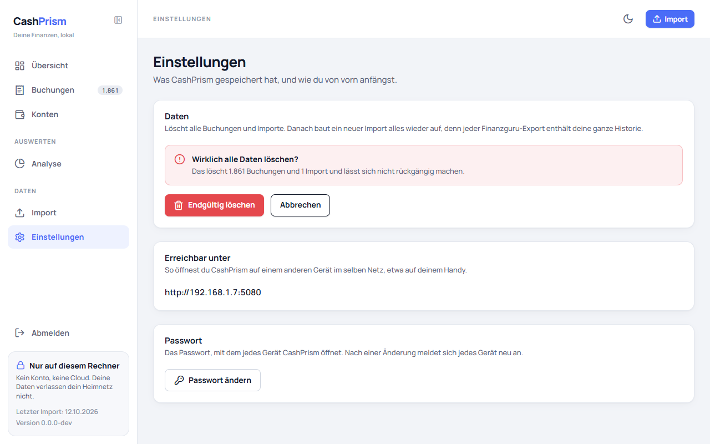

Unter *Einstellungen* löscht *Alle Daten löschen* jede gespeicherte Buchung,
jeden bisherigen Import und jeden ausgeblendeten Hinweis auf einen
[überfälligen Vertrag](#die-verträge). Danach baut ein neuer Import alles wieder auf, denn
jeder Finanzguru-Export enthält deine ganze Historie. Das ist der Weg, wenn eine
neue Version von CashPrism mehr aus dem Export speichert als die alte: löschen,
dann den neuesten Export importieren.

Nach dem Klick fragt die Seite nach und nennt, wie viele Buchungen und Importe
verschwinden. Erst *Endgültig löschen* löscht, *Abbrechen* lässt alles, wie es
ist. Rückgängig machen lässt sich das Löschen nicht. Weil auch die bisherigen
Importe verschwinden, nimmt CashPrism danach auch eine Datei an, die es vorher
schon kannte. Solange nichts gespeichert ist, lässt sich die Schaltfläche nicht
anklicken.

Deine [Kontogruppen](#kontogruppen) bleiben beim Löschen erhalten: Nach dem
nächsten Import steht jedes Konto wieder in seiner Gruppe. Kreuzt du in der
Rückfrage *Kontogruppen ebenfalls löschen* an, verschwinden auch sie, und
*Konten* beginnt wieder mit der einen Gruppe *Konten*. Das Kreuz ist bei jeder
Rückfrage zunächst nicht gesetzt.
